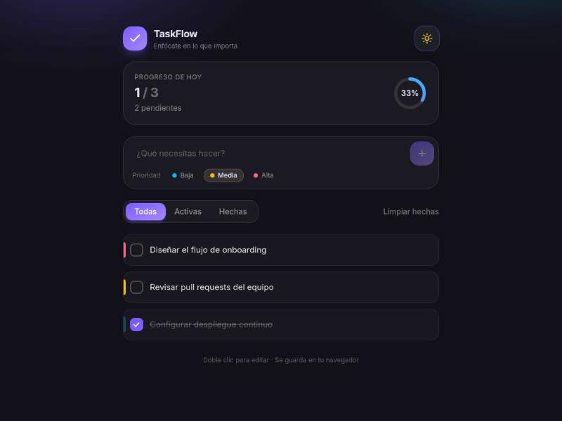
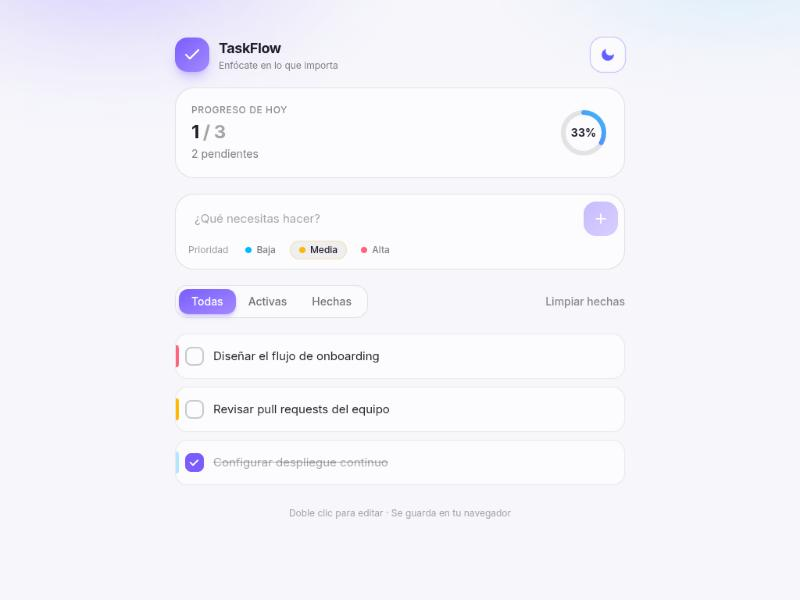

# TaskFlow

A minimal task manager focused on speed and clarity. Add tasks with a priority, filter by state, watch progress update as you go, and switch between light and dark themes. Everything is stored in the browser, so there is no backend to run.

**Live demo:** [task-flow-gamma-nine.vercel.app](https://task-flow-gamma-nine.vercel.app)



## Features

- Create, edit inline (double click), complete and delete tasks
- Low / medium / high priority with a color indicator
- Filter by all, active or completed
- Progress ring that reflects completion in real time
- Tasks and theme preference persist in `localStorage`
- Light and dark themes

## Stack

- React 19 with TypeScript
- Vite
- Tailwind CSS v4
- Oxlint

## Architecture

```
src/
├── components/   UI by responsibility (Header, Composer, Filters, TaskItem…)
├── hooks/        Reusable logic (useTasks, useTheme, useLocalStorage)
├── types.ts      Domain model (Task, Priority, Filter)
└── App.tsx       View composition
```

State and persistence live in hooks that are decoupled from the UI, which keeps the components declarative.

## Running locally

```bash
git clone https://github.com/Sagudelo01/task-flow.git
cd task-flow
npm install
npm run dev
```

The app runs at `http://localhost:5173`.

| Script | Description |
|---|---|
| `npm run dev` | Start the dev server |
| `npm run build` | Production build |
| `npm run preview` | Serve the production build |
| `npm run lint` | Run Oxlint |
| `npm test` | Run the test suite (Vitest) |

## Light mode


